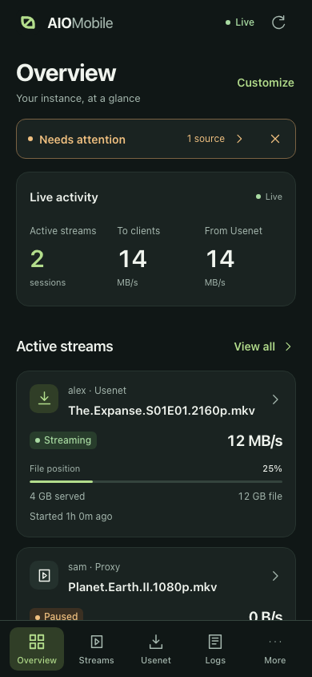
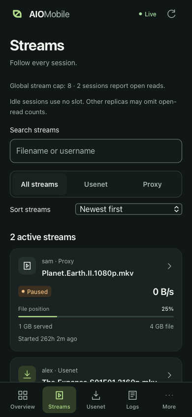
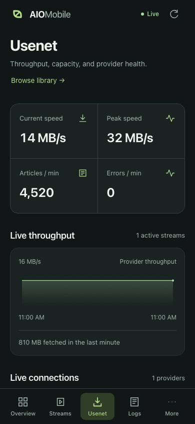
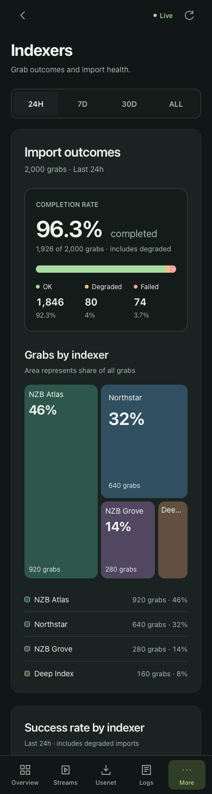
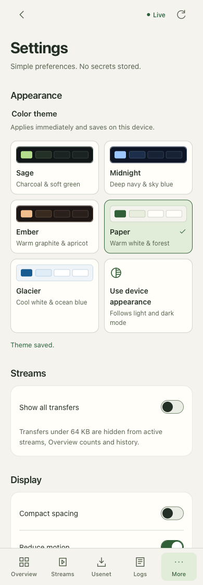

<div align="center">


# AIOMobile

**Your AIOStreams dashboard, made for your phone.**

Streams, Usenet, bandwidth and logs in an installable web app.<br>
Connects to your existing [AIOStreams](https://github.com/Viren070/AIOStreams) instance using its admin login.

[Get started](#get-started) · [User guide](docs/usage.md) · [Changelog](CHANGELOG.md)

</div>

## A look inside

| Overview | Streams | Usenet |
| :---: | :---: | :---: |
|  |  |  |

<details>
<summary>Indexers and settings</summary>

| Indexers | Settings · Paper |
| :---: | :---: |
|  |  |

</details>

<sub>Captured October 30, 2026, with synthetic demo data.</sub>

## What you can do

- **See what’s streaming.** Live speeds, furthest observed file position and searchable session history. Tiny transfers stay hidden by default; show them in Settings.
- **Watch Usenet activity.** Provider priority groups, live connections, throughput and retained usage charts.
- **Check imports and health.** Indexer outcomes, success rates, addon health, background tasks and media information.
- **Make it yours.** Five themes, customizable Overview sections and a Home Screen app on iPhone.

Static frontend, no separate backend. Monitoring data stays out of the offline cache.

## Get started

You need an HTTPS AIOStreams instance with admin access and the [supported dashboard APIs](docs/api-contract.md).

1. Follow the **[installation guide](deploy/INSTALL.md#install-from-source-with-traefik)** for Docker + Traefik, or [use another reverse proxy](deploy/INSTALL.md#other-reverse-proxies).
2. Open **`https://YOUR-AIOSTREAMS-HOST/mobile/`**, leave **AIOStreams base URL** blank, and sign in.
3. On iPhone, use Safari’s **Share → Add to Home Screen**. Sign in again inside the installed app if needed.

Already installed? Follow the [update guide](deploy/INSTALL.md#updating-an-existing-deployment), then tap **Update** when the app prompts you.

## Development

Requires Node.js **22.18+** and npm.

```sh
npm ci
npm run dev
```

Open `http://localhost:5173/mobile/`. Set `AIO_DEV_TARGET=https://aio.example.com` to proxy an instance during development; production cookies are separate from localhost.

```sh
npm run lint
npm test
npm run build
npx playwright install chromium webkit
npm run test:e2e
```

The build writes `dist/`. Browser tests use synthetic fixtures. See [validation](docs/validation.md) and [release packaging](deploy/INSTALL.md#building-release-archives) for details.

---

[User guide & troubleshooting](docs/usage.md) · [API contract](docs/api-contract.md) · [AGPL-3.0 license](LICENSE) · [Attribution](NOTICE)
